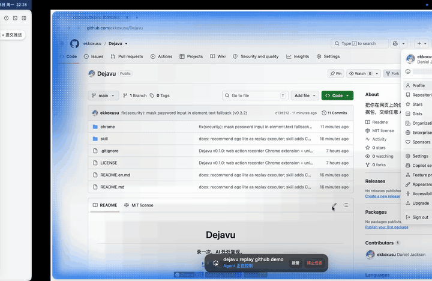

<div align="center">

# Dejavu

**Record once. Replay anywhere with AI.**

**English** | [简体中文](README.md)

[](https://developer.chrome.com/docs/extensions/develop)
[](skill/SKILL.md)
[](LICENSE)

A Chrome extension + a universal AI Skill: record any web operation into a standard data package, then hand it to any AI Agent for faithful replay.



> ⬆️ Live recording: an AI replays the user's GitHub flow from a recording package (open repo → Profile → pinned repo → hit Star)

**If Dejavu helps you, please give it a ⭐ Star on [GitHub](https://github.com/ekkoxusu/Dejavu) — it's the best way to support the project!**

</div>

---

## Why Dejavu?

Repetitive web tasks drain your time every day: logging into dashboards to pull data, walking through checkout flows, filling out identical forms, demoing procedures to colleagues…

Dejavu turns "a human does it once" into "AI does it countless times":

```
You operate the browser ──► Dejavu records ──► recording-*.zip ──► AI Agent replays
       (once)           (actions/shots/network)  (standard package)     (countless times)
```

## ⚡ Dejavu vs Chrome DevTools Recorder

In one sentence: **Recorder produces automation scripts for engineers; Dejavu produces operation data packages for AI** — the former ends at code, the latter ends with an Agent doing the work for you.

| Dimension | Chrome DevTools Recorder | Dejavu |
|---|---|---|
| Usage | F12 → Recorder panel, developer-oriented | Click the icon, one click start/stop |
| Output | User flow → exported Puppeteer/Playwright scripts | `recording-*.zip`: actions + network + per-step screenshots |
| Consumer | Engineers writing tests/CI | Any AI Agent with the universal skill — zero code |
| Replay behavior | **Scripts are rigid — any UI change breaks them** (a human must fix) | **AI adapts**: graceful selector fallback, dynamic recovery when the page changes |
| Token capture | ❌ | ✅ One-click request-header monitoring + copy |
| Per-step screenshots | ❌ steps list only | ✅ one JPEG per action for frame-by-frame comparison |
| Network baseline | ❌ export HAR yourself | ✅ network.json bundled (tokens redacted) |
| Password handling | Recorded in plain text, delete steps manually | Auto-masked as `***` |

> Recorder remains a great starting point for CI test scripts; Dejavu aims to let **non-programmers** hand their workflows to AI for replay.

## ✨ Features

- **🔎 Token Capture** — One-click request-header monitoring. Log in as usual and `Authorization` / `x-token` headers are captured automatically; copy with one click
- **🎬 Full Action Recording** — Clicks, inputs, Enter, scrolling, form submissions, page navigations — all shown live in the sidebar
- **📸 Per-Step Screenshots** — Every action carries a screenshot of that exact moment, so the AI can compare page state frame by frame during replay
- **🌐 Network Baseline** — A summary of all requests during recording, letting the AI verify results or call APIs directly, skipping the UI
- **♻️ Universal Replay Skill** — Replay logic ships as a standalone, standard Agent Skill: install once, replay every recording, on any platform
- **🧠 Adaptive AI Replay** — A recording captures intent, not a dead script: selectors degrade gracefully (testid → id → aria → CSS → text), and the AI dynamically reroutes when the page structure changes (in a real test, filling a select by recorded value failed — the AI recovered by matching the option text instead)
- **🔒 Local-First** — All data stays on your machine; nothing is uploaded. Passwords are masked, tokens are redacted in network logs

## 🚀 Quick Start

### 1️⃣ Install the Chrome Extension

1. Clone the repo:

```bash
git clone https://github.com/ekkoxusu/Dejavu.git
```

2. Open `chrome://extensions` and enable **Developer mode** (top right)
3. Click **Load unpacked** and select the [`chrome/`](chrome/) directory of this repo

### 2️⃣ Install the Replay Skill (once — works for all future recordings)

**Option A · One-line AI install** — Send this message verbatim to your AI assistant (Claude Code / Codex CLI / ZCode, or any agent that can run commands):

```
Install the Dejavu replay skill for me by running:
mkdir -p ~/.claude/skills/dejavu-replay && curl -fsSL https://raw.githubusercontent.com/ekkoxusu/Dejavu/main/skill/SKILL.md -o ~/.claude/skills/dejavu-replay/SKILL.md
```

> On ZCode, change the target directory to `~/.agents/skills/dejavu-replay/`.

**Option B · Manual install** — Copy the [`skill/`](skill/) directory into your platform's skills directory:

| Platform | Skills directory |
|---|---|
| Claude Code | `~/.claude/skills/dejavu-replay/` |
| ZCode & other agent CLIs | `~/.agents/skills/dejavu-replay/` |
| workBuddy & other platforms | The platform's skill directory — see its docs |
| Chats without skill support | Paste the contents of [skill/SKILL.md](skill/SKILL.md) into the conversation — same effect |

### 3️⃣ Record → Replay

1. Click the extension icon to open the sidebar → **Start Recording**
2. Use the page normally (log in, click, fill in forms…) — every action appears live in the sidebar
3. **Stop & Generate ZIP** → you get `recording-<domain>-<timestamp>.zip`
4. Send the zip (or its unzipped folder) to an AI with the Skill installed: "Replay this recording with the dejavu-replay skill"
5. The AI replays the steps; passwords appear as `***` in recordings, and the AI will ask you for real credentials when needed

> Token capture is a standalone feature: click **Get Token** in the sidebar → operate the page → click **Copy**.

### 🎯 Recommended Replay Executor

When replaying on real websites with anti-bot protection (slider CAPTCHAs, login checks), we recommend the [**ego lite browser**](https://lite.ego.app/zh-cn/download?auto=1) as the executor — it lets the AI inherit your everyday browser's **login sessions and real fingerprint**, so it won't get blocked by CAPTCHAs the way a clean automation instance does (verified with a 23-step replay on qidian.com in one pass). The replay skill also suggests this whenever it hits a CAPTCHA.

## 📦 What's in a Recording (formatVersion 1)

```
recording-<domain>-<timestamp>.zip
├── actions.json      # Semantic action sequence (type / selector / text / value / screenshot refs)
├── network.json      # Network baseline (method / url / status, tokens redacted)
├── metadata.json     # Start/end URLs, duration, action count, UA, formatVersion
└── screenshots/      # One JPEG per action
```

Full field reference and replay rules: [skill/SKILL.md](skill/SKILL.md) (in Chinese).

## 🔒 Privacy & Security

- Recording data lives only in your browser and Downloads folder — Dejavu has no backend
- `type=password` values are recorded as `***`; you supply real credentials at replay time
- Tokens in `network.json` are always redacted
- For sensitive actions (submit / order / delete), the Skill requires the AI to confirm with you before executing

## 📁 Repository Layout

```
dejavu/
├── chrome/   # Chrome extension (MV3, plain JS, no build step — load and go)
└── skill/    # Universal replay Skill (SKILL.md, standard Agent Skill format)
```

## 🤝 Contributing

Issues and PRs are welcome. When iterating on the recording format, update both `skill/SKILL.md` and the `formatVersion` in `chrome/sidepanel/sidepanel.js`.

**Finding Dejavu useful? Give it a ⭐ Star on [GitHub](https://github.com/ekkoxusu/Dejavu) so more people can discover it!**

## License

[MIT](LICENSE)
