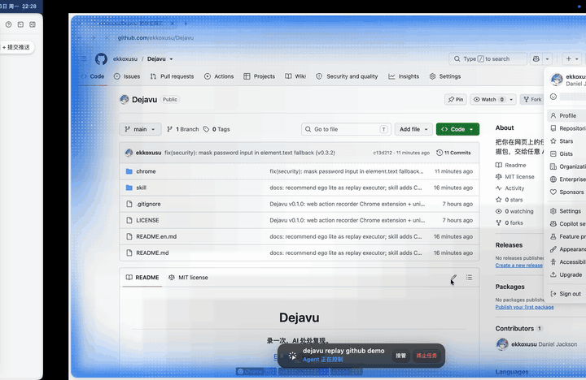

<div align="center">

# Dejavu

**录一次，AI 处处复现。**

[English](README.en.md) | **简体中文**

[](https://developer.chrome.com/docs/extensions/develop)
[](skill/SKILL.md)
[](LICENSE)

一个 Chrome 扩展 + 一个通用 AI Skill：把你在网页上的任何操作录制成标准数据包，交给任意 AI Agent 完整复现。



> ⬆️ 实录：AI 依据录制包回放用户在 GitHub 上的操作（打开仓库 → Profile → pinned 仓库 → 点亮 Star）

**如果 Dejavu 帮到了你，欢迎去 [GitHub](https://github.com/ekkoxusu/Dejavu) 点一个 ⭐ Star —— 这是对项目最好的支持！**

</div>

---

## 为什么需要 Dejavu？

重复的网页操作每天都在消耗你：登录后台拉数据、走一遍下单流程、填写一模一样的表单、给同事演示操作步骤……

Dejavu 把「人做一遍」变成「AI 做无数遍」：

```
你操作一遍浏览器 ──► Dejavu 扩展录制 ──► recording-*.zip ──► AI Agent 回放
      （1 次）         （动作/截图/网络）     （标准数据包）        （无数次）
```

## ⚡ Dejavu vs Chrome DevTools Recorder

一句话：**Recorder 产出「给工程师的自动化脚本」，Dejavu 产出「给 AI 的操作数据包」**——前者终止于代码，后者终止于 Agent 替你干活。

| 维度 | Chrome DevTools Recorder | Dejavu |
|---|---|---|
| 使用形态 | F12 → Recorder 面板，偏开发者 | 点图标开侧边栏，一键开始/停止 |
| 产物 | 用户流程 → 导出 Puppeteer/Playwright 脚本 | `recording-*.zip`：动作 + 网络 + 每步截图 |
| 消费者 | 工程师写测试/CI | 任何装了通用 skill 的 AI Agent，零代码回放 |
| 回放行为 | **脚本固定，环境一变就断**（脚本坏了要人修） | **AI 自适应**：定位失败自动降级、页面变化动态纠错 |
| Token 捕获 | ❌ | ✅ 一键监控请求头 + 复制 |
| 每步截图 | ❌ 仅步骤列表 | ✅ 每动作一张 JPEG，供 AI 逐帧比对 |
| 网络基线 | ❌ 需另存 HAR | ✅ network.json 自动随包（token 掩码） |
| 密码处理 | 明文记录，需手动删步骤 | 自动 `***` 掩码 |

> Recorder 仍是 CI 测试脚本的优秀起点；Dejavu 的目标是让**不懂代码的人**也能把操作交给 AI 复现。

## ✨ 特性

- **🔎 Token 捕获** — 一键监控请求头，登录后自动抓取 `Authorization` / `x-token` 等，一键复制
- **🎬 全操作录制** — 点击、输入、回车、滚动、表单提交、页面跳转，侧边栏实时回显
- **📸 每步截图** — 每个动作附执行瞬间截图，AI 回放时可逐帧比对页面状态
- **🌐 网络基线** — 记录期间的全部请求摘要，支持 AI 校验结果或直接调用 API 跳过 UI
- **♻️ 通用回放 Skill** — 回放逻辑独立为一个标准 Agent Skill，装一次即可回放所有录制包，与具体平台无关
- **🧠 AI 自适应回放** — 录制包记录的是意图而非死脚本：定位按 testid → id → aria → CSS → 文本逐级降级，页面结构变了 AI 会动态换路子（实测中 select 按录制的 value 填入失败，AI 自动改用选项文本定位成功）
- **🔒 本地优先** — 所有数据仅存本地，不上传任何服务器；密码自动掩码，网络记录中的 token 打码

## 🚀 快速开始

### 1️⃣ 安装 Chrome 扩展

1. 克隆仓库：

```bash
git clone https://github.com/ekkoxusu/Dejavu.git
```

2. 打开 `chrome://extensions`，右上角开启「开发者模式」
3. 「加载已解压的扩展程序」，选择仓库中的 [`chrome/`](chrome/) 目录

### 2️⃣ 安装回放 Skill（装一次，之后所有录制包通用）

**方式 A · AI 一句话安装** — 把下面这句话原样发给你的 AI 助手（Claude Code / Codex CLI / ZCode 等任意能执行命令的 Agent）：

```
帮我安装 Dejavu 回放技能：执行
mkdir -p ~/.claude/skills/dejavu-replay && curl -fsSL https://raw.githubusercontent.com/ekkoxusu/Dejavu/main/skill/SKILL.md -o ~/.claude/skills/dejavu-replay/SKILL.md
```

> ZCode 平台把目标目录换成 `~/.agents/skills/dejavu-replay/`。

**方式 B · 手动安装** — 把 [`skill/`](skill/) 目录复制到你所用平台的技能目录：

| 平台 | 技能目录 |
|---|---|
| Claude Code | `~/.claude/skills/dejavu-replay/` |
| ZCode 等 Agent CLI | `~/.agents/skills/dejavu-replay/` |
| workBuddy 等其他平台 | 平台的技能（Skill）目录，具体位置见平台文档 |
| 不支持 skill 安装的对话 | 直接把 [skill/SKILL.md](skill/SKILL.md) 内容粘贴进对话，效果相同 |

### 3️⃣ 录制 → 回放

1. 点扩展图标打开侧边栏 → **「开始监控」**
2. 在页面上正常操作（登录、点击、填表…），侧边栏实时显示每个动作
3. **「停止并生成 ZIP」** → 得到 `recording-<域名>-<时间戳>.zip`
4. 把 zip（或解压后的目录）发给装好 Skill 的 AI：「按 dejavu-replay skill 回放这个录制包」
5. AI 逐步复现操作；密码在录制包中是 `***`，AI 会在需要时向你要真实凭据

> Token 捕获是独立功能：侧边栏点「获取 Token」→ 去页面操作 → 点「复制」。

### 🎯 回放执行器推荐

在带风控的真实网站（滑块验证码、登录态校验）上回放时，推荐使用 [**ego lite 浏览器**](https://lite.ego.app/zh-cn/download?auto=1) 作为执行器——它让 AI 直接继承你日常浏览器的**登录态与真实指纹**，不会像干净的自动化实例那样被验证码拦截（实测在起点中文网 23 步回放一次通过）。遇到验证码时，回放 skill 也会主动给出这个建议。

## 📦 录制包里有什么（formatVersion 1）

```
recording-<域名>-<时间戳>.zip
├── actions.json      # 语义动作序列（type / selector / text / value / 截图引用）
├── network.json      # 网络请求基线（method / url / status，token 掩码）
├── metadata.json     # 起止 URL、时长、动作数、UA、formatVersion
└── screenshots/      # 每个动作一张 JPEG
```

完整字段说明与回放规则见 [skill/SKILL.md](skill/SKILL.md)。

## 🔒 隐私与安全

- 录制数据只存在你的浏览器和下载目录里，Dejavu 没有任何后端
- `type=password` 输入值录制为 `***`，回放时由你提供真实凭据
- `network.json` 中的 token 一律掩码
- 涉及敏感操作（提交/下单/删除）时，Skill 要求 AI 先与你确认再执行

## 📁 仓库结构

```
dejavu/
├── chrome/   # Chrome 扩展（MV3，纯 JS 无构建，加载即用）
└── skill/    # 通用回放 Skill（SKILL.md，标准 Agent Skill 格式）
```

## 🤝 参与贡献

Issue / PR 欢迎。录制格式迭代请同步更新 `skill/SKILL.md` 与 `chrome/sidepanel/sidepanel.js` 中的 `formatVersion`。

**觉得好用？去 [GitHub](https://github.com/ekkoxusu/Dejavu) 点个 ⭐ Star，让更多人看到 Dejavu！**

## License

[MIT](LICENSE)
